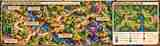

# Kingdom of the Fold: Game Design Document (GDD)

> **Status:** design baseline updated 2026-10-20. Current implementation state and exact balance values remain tracked in `docs/PLAN.md` and `godot/content/`.
> **Former working title:** Papercraft Kingdom Defense. The repository remains `psychic-bassoon`; this title change does not change technical identifiers or stable simulation IDs.

## 1. Executive summary

### High concept

**Kingdom of the Fold** is a premium, painterly low-poly fantasy tower-defense game built in Godot 4. Players defend a handcrafted folded-paper kingdom against waves of corrupted paper creatures by placing specialized towers, choosing upgrade branches, casting craft magic, and moving a hero across a tactical valley.

The game combines three readable layers:
1. **Tower defense:** a curved, legible enemy route, fixed tower sockets, upgrades, wave planning, and a defended Heartstone.
2. **Light RTS tactics:** one controllable hero can move across walkable terrain to support a threatened bridge or intercept a fast enemy.
3. **Battlefield control:** elevation, bridges, support auras, marks, slows, armour and air threats make tower placement and unit combinations matter.

It is not a full RTS: no worker economy, unrestricted base building, or direct control of multiple armies. The core loop remains wave-based tower defense.

### Pillars

- **Hand-folded fantasy:** a boundless valley of layered card, kraft cliffs, folded trees, wooden bridges and magical water.
- **Readable at a glance:** silhouette, colour family, and one signature prop communicate every unit's role at overview zoom.
- **Tactical, not twitchy:** a small number of meaningful building positions and a movable hero; decisions matter more than rapid inputs.
- **Touch-first:** landscape layout, comfortable hit targets, one-thumb-compatible actions and clear feedback.
- **A living valley:** seeded layouts and natural terrain variation make runs feel distinct without obscuring routes or sockets.

## 2. Narrative and world

### The War of the Cutting Mat

The kingdom was folded into being by the Grand Crafter from paper, recycled card, thread and small wooden pieces. Its peaceful paper folk lived in a miniature realm until **the Blot**, a bottle of corrupted purple India ink, spilled its magic into the fibres of the world. Ink-corrupted scraps became aggressive creatures that seek to tear the kingdom apart.

The lore's origin is a craft room, but the **on-screen world is a complete fantasy valley**. Do not show a physical desk, cutting mat, masking-tape road, tabletop edge or display plinth. The valley should feel boundless, with terrain fading into atmospheric haze.

The player is the **Grand Crafter**, directing defenders and protecting the Heartstone inside the **Heartkeep**—a small, readable fortified castle whose health is represented by its glowing heart crystal.

### Storytelling principles

- Kingdom-made structures are orderly, folded and glued, using warm kraft, parchment, wood and restrained blue/gold details.
- Blot corruption is offset, torn, stained and asymmetrical, with purple magic kept as an intentional accent.
- The Messenger Crow delivers wave warnings, tactical hints and short story beats without obscuring combat.
- Environmental landmarks tell the story; lengthy exposition is not required during active waves.

## 3. Core loop and controls

### Run loop

1. **Scout and build:** inspect the route, feeder entrance, bridges, terrain elevations and tower sites; spend Buttons on towers or upgrades.
2. **Prepare the wave:** review warnings and enemy composition. The player may start a wave early for a bonus; wave 1 always waits for the player.
3. **Defend:** towers target enemies, guards block eligible ground foes, the hero moves to respond to threats, and craft spells spend regenerating PVA Ink / Crafting Energy.
4. **Recover and improve:** earn wave rewards and Golden Staples based on performance and remaining Heartstone health; spend Staples in the persistent workshop tree to unlock blueprints and permanent improvements.

### Main HUD

- Top-left: Buttons, Heartstone health, current wave / total waves, and PVA Ink / Crafting Energy when available.
- Top-right: Menu, Pause/Resume, speed cycling (1×, 2×, 3×).
- Bottom-left: Start Wave and Auto. Auto starts the next wave three seconds after a wave is cleared; it never starts wave 1 automatically and never calls a wave early.
- Selected tower: contextual build/upgrade/sell and targeting information.
- Toolbox tray: global craft spells with a live placement preview and cost/availability state.
- Messenger Crow: non-combat alert delivery.

Keep the HUD in a `CanvasLayer`; it is not part of the world geometry. The interface must avoid covering the route, hero, bridge holds or the Heartkeep during combat.

### Touch and camera

- Landscape layout designed first for iPhone and tablet, with macOS, Windows and Linux supported.
- Minimum target size: approximately 48 pt for primary touch interactions.
- One-finger drag pans with bounded easing; two-finger pinch controls zoom.
- Tapping a socket opens a contextual build/upgrade menu offset above the finger.
- The hero is selected and issued movement commands by tapping or dragging to walkable terrain.
- Spells use drag-to-target placement, a ground-projected preview and a clear cancel action.
- The camera stays smooth; characters and projectiles may use stepped 12 fps stop-motion animation.

## 4. Map system and level design

### Logical layout

- **Grid:** 32 columns × 20 rows; approximately 1 × 1 world units per logical cell.
- **Route geometry:** grid route data is converted into curves that are the source of truth for enemy movement, range, hits and visuals. Do not merely smooth the rendered line while enemies follow square corners.
- **Primary route:** one continuous main enemy route from a visible spawn to the Heartkeep, with long sweeps, S-bends, U-turns, ridge edges, open firing lanes and purposeful chokepoints.
- **Later-wave feeder:** a secondary source follows a distinct route and joins the main route before the final defence. It adds pressure without turning the experience into a branching maze; exact activation wave belongs in wave content.
- **Tower sites:** approximately 24–30 potential 2 × 2 cell sockets on a large valley. They are deliberately spaced and placed within useful reach of the road, not on every non-road cell.
- **Elevation:** a valley floor, lower terraces, intermediate shelves and scarce high ground. Current high-ground rules give the highest socket level +15% range where supported.
- **River:** a blue river in a gorge that crosses the enemy road only at purposefully placed bridges. Bridges must leave usable ground at both ends.
- **Walkability:** the hero moves over designated walkable terrain away from the enemy road. Water and tall cliffs block movement unless a bridge or authored transition connects them.

### Tactical region principles

A hand-authored reference map should communicate six distinct region types. Procedurally generated maps may combine or reinterpret them rather than hard-code six identical zones.

1. **Outer March:** a forested entrance with early tower sites and room to engage small waves.
2. **Broken Ridge:** high-ground firing positions above a curved road and lower hero-walkable ground.
3. **Bluewater Crossing:** defended bridge chokepoint with safe approach space for guards and the hero.
4. **Sunken Meadow:** open walkable space to reposition the hero between defensive fronts.
5. **Ancient Fold:** a ruined pass and a useful route-merge landmark, with mixed elevation and tower opportunities.
6. **Heartkeep Approach:** a compact final defensive line around the castle objective.

### Tower site and terrain rules

- Placement foundations are built into the landscape, not thin debug-like white circles.
- Each location should have an identifiable tactical purpose: long-range coverage, a corner, a chokepoint, a support cluster, an anti-air lane or a later feeder.
- Avoid identical spacing. Preserve the silhouette of the route and never let props obscure sockets, enemies or bridge approaches.
- High terrain should feel valuable without forming walls that make towers or enemies unreadable.
- Provide at least two meaningful walkable connections between important regions where terrain allows, so hero movement is a tactical option rather than road-following.

### Folded Valley reference image

The image below is an **illustrative level-design reference**, not an authoritative procedural seed or collision/navigation map. Use the current constraints in `godot/content/map_rules.gd` and `docs/lessons/2026-10-18-valley-map.md` for implementation.

[Open the editable tactical schematic](art/maps/folded-valley-tactical-concept.svg).

## 5. Towers, upgrades and tower skills

The full expanded tower specification—including role matrix, current simulation baselines, visual silhouettes, Tier-IV branches, proposed values, synergies and status labels—is maintained in [`docs/UNIT_ROSTER.md`](UNIT_ROSTER.md). This section defines the progression contract.

### Upgrade progression

- **Tier I → Tier II → Tier III:** linear upgrades to core statistics and/or reliability. Each tier adds a visible, modelable part and must preserve the tower's recognisable base silhouette.
- **Tier IV:** after Tier III, choose one of two specialisations. A specialisation has one active ability and one passive ability.
- Tier IV is a meaningful commitment; the two branches must alter tactics, not merely colour.
- Current combat values in `godot/content/towers.gd` and `godot/content/specs.gd` remain authoritative for implemented behaviour. New values in `docs/UNIT_ROSTER.md` are proposals until implemented and balanced.

### Tower families

| Tower | Primary role | Signature construction |
|---|---|---|
| Spool Guard | Fast physical single-target; anti-air | Thread spool, button turntable, toothpick/lolly-stick ballista |
| Thimble Mortar | Slow ground splash damage | Dull thimble barrel in a heavy cardboard cradle |
| Prism Spire | Sustained magical beam; anti-air | Tall rolled-paper tower, faceted cyan prism |
| Guard Tent | Deploys two melee guards to hold eligible enemies | Folded A-frame pavilion, thread guy-lines, pin pegs |
| Kitchen Mess Tent | Support aura for guards | Wide folded pavilion, ration bundles, pot-and-ladle crest |
| Quillwatch Beacon *(proposed)* | Marks priority targets for focus fire | Quill pointer and cyan kite-lens on a tall mast |
| Briar Loom *(proposed)* | Ground control / snares | Low forked frame with a clearly readable X of tensioned thread |
| Button Press *(proposed)* | Capped economy support | Compact fantasy press and button-token tray |

## 6. Heroes, movement and hero skills

Only one directly controlled hero should be active at a time in the initial release. Other heroes are selectable/unlockable choices, not four independently commanded units. This keeps movement and active skills practical on mobile.

- **Knight of Cardboard:** frontline defender; passive **Rally Cry** buffs nearby allies; active **Blade Whirl** deals close-range area damage (15 s GDD cooldown).
- **Camp Cook:** support/control hero; passive **Rations and Morale** heals nearby troops and grants a small damage-resistance bonus; active **Boiling Stew Splash** burns and slows enemies.
- **Foldrunner** *(proposed):** mobile hunter; passive **Roadwise** improves movement around the route and reduces some ground-control penalties; active **Severing Dash** cuts through a target line.
- **Lantern Scribe** *(proposed):** ranged support/dispel; passive **Clear Script** weakens nearby enemy buffs; active **Unblot the Page** removes eligible shields/buffs and briefly slows enemies in an area.

Exact hero stats and detailed effects are listed in `docs/UNIT_ROSTER.md`. Hero progression should improve abilities and add broad visible paper/armour components, not simply scale the model.

## 7. Enemy roster and wave escalation

The enemy roster expands from five established archetypes to twelve. Established simulation values remain in `godot/content/foes.gd`; additions and their draft values are explicitly marked as proposals in `docs/UNIT_ROSTER.md`.

| Enemy | Role / gameplay lesson |
|---|---|
| Scrap Goblin | Fast low-health swarm; tests single-target coverage and splash |
| Corrugated Orc | Slow armoured bruiser; tests sustained damage and armour answers |
| Ink Shaman | Heals and accelerates nearby enemies; priority support target |
| Razor Moth | Flyer that bypasses ground blockers; explicit anti-air check |
| Cardboard Golem | Established boss; heavy, un-blockable, spawns Goblins on defeat |
| Tackrunner *(proposed)* | Sudden speed burst; tests reaction and interception |
| Glue Ooze *(proposed)* | Leaves a temporary hazard that disrupts mobile defenders |
| Ink Acolyte *(proposed)* | Grants temporary shields; tests target priority and dispel |
| Waxbound Beetle *(proposed)* | Armoured, partially magic-resistant heavy |
| Paperwing Bomber *(proposed)* | Heavier flyer that drops a telegraphed ink hazard |
| The Binder *(proposed)* | Summoner boss with capped adds and a readable support effect |
| Inkheart Colossus *(proposed)* | Multi-phase final boss and full-roster test |

### Wave principles

- The standard run uses 20 waves as its current design target.
- Introduce one new core mechanic at a time and telegraph flyers, support enemies, hazards and boss phases before they cause pressure.
- Mix roles rather than only scaling health and speed.
- Provide counters but avoid a single mandatory tower composition.
- Boss summons are capped; bosses are not blockable; bosses resist long hard-control effects.
- Wave counts and timings are balance data, not canonical lore. Keep them in `godot/content/waves.gd` or an equivalent data-only resource.

## 8. Craft spells, abilities and naming

The GDD-defined global craft spells remain:

1. **PVA Glue Trap:** coats a route segment and slows ground enemies by 60% for 8 seconds.
2. **Falling Thumbtacks:** damages a 2 × 2 target area and briefly makes light enemies stumble.
3. **The Crafter's Eraser:** removes eligible non-boss armour, shields and positive magical buffs in a target radius.

These are distinct from tower Tier-IV actives and hero actives. Some later HUD concepts show **Ice Dart, Glue Patch, Ink Bomb, Reinforce and Confetti Blast**. Treat those five labels as a UI concept, not a settled global-spell roster, until a separate design decision maps each to a tower skill, hero skill or global spell. Do not implement duplicate Glue Trap/Glue Patch mechanics under different names without explicit intent.

The Messenger Crow is a non-combat alert and story messenger, not an enemy or hero.

## 9. Persistent progression and economy

- **Buttons:** in-run currency for building and upgrading towers.
- **Golden Staples:** between-run currency, earned in relation to performance and remaining Heartkeep/Heartstone health.
- **PVA Ink / Crafting Energy:** regenerating resource for global spells.
- **Workshop tree:** permanent improvements, blueprint unlocks and carefully bounded run modifiers.

The proposed Button Press is an optional economy tower, not a replacement for the persistent workshop tree. Its income must be capped per wave, must not trigger recursively, and must not generate extra rewards from summoned enemies or boss phase adds.

## 10. Visual design system

Follow [`docs/art/STYLE.md`](art/STYLE.md) and [`docs/UNIT_ROSTER.md`](UNIT_ROSTER.md).

### Non-negotiable rules

1. **Squarish, not voxel:** chunky, bevelled forms and a few broad planes; no stacked perfect cubes.
2. **Painterly, not flat:** warm highlights, cool shadows, broad gradients and strong contact shading; no toon bands or cel-shading.
3. **Paper, not plastic:** matte cardstock, kraft, cut edges, folds and corrugation. Only water and magic may shine; the Blot's wet ink is the exception.
4. **Readable at gameplay distance:** silhouette, palette and signature prop must carry the role at overview zoom.

### Lighting and palette

- Warm amber directional key light; cool pale-blue fill; teal-blue shadows.
- Grass: lit/dry/shade `#6f8f3a` / `#a39a52` / `#4a6a2c`.
- Kraft cliffs / dark layer: `#b9773c` / `#5a3418`; soil lip `#3e2b1c`.
- Road light / worn edge: `#d9b98a` / `#b89262`.
- Water: `#7fc4f2` / `#2f6fbf`.
- Friendly magic: cyan `#5ff0ff`; Blot corruption: controlled violet-purple.
- Keep the main playfield sharp and readable; haze should soften the far valley, not the active route or units.

### Animation and asset pipeline

- Use Blender models with stable node names and separate moving parts where needed.
- Export GLB assets for Godot 4; use the shared `PK_Painted` / `PK_Magic` material direction where available.
- Character and projectile motion can be stepped at approximately 12 fps; camera and UI remain smooth.
- Keep mobile-renderer contact shading readable without relying on desktop-only SSAO/SSIL.

## 11. Audio direction

Use tactile craft-room foley to make the fantasy world feel handmade:
- Thread and rubber-band twangs for ballista and tensioned mechanisms.
- Muted thimble clinks and cardboard thuds for mortar and heavy impacts.
- Glass-rim chimes and gentle cyan hums for the Prism Spire.
- Paper tears, scissor snaps and card impacts for melee.
- Stamp-like thuds for boss footsteps and UI confirmations.

Adaptive soundtrack layers:
- Planning: light acoustic strings, marimba, soft paper rustles.
- Active wave: rhythmic cardboard percussion, pizzicato strings and lively woodwinds.
- Boss / urgent Heartkeep health: stronger percussion, brass and lower strings.

## 12. Godot architecture and data contract

Keep the simulation deterministic and data-first. Stable IDs do not change when display names change. Keep unit data separate from visuals so an art rework cannot silently change combat.

- `godot/content/towers.gd`: implemented tower costs, stats and tower behaviour configuration.
- `godot/content/specs.gd`: implemented Tier-IV tower specialisations.
- `godot/content/foes.gd`: implemented foe baselines and special flags.
- `godot/content/waves.gd`: wave compositions and later feeder activation.
- `godot/content/map_rules.gd`: 32 × 20 board, curved route and socket rules.
- Rendering and HUD nodes remain separate from the pure simulation; use `CanvasLayer` for HUD elements.

Use shared timed status models for slow, freeze/root, bleed, blind, armour reduction, marks, shields, healing, buffs, summons and temporary ink hazards. Define refresh, stacking and boss-resistance behaviour centrally. Anti-air, heavy, blockable, support-priority and summon flags must be explicit data, not inferred only from visuals.

### Content status and balance policy

- **Established/current:** names and values already present in the GDD or current Godot content, with the implementation status stated accurately.
- **GDD-defined / implementation pending:** intended behaviour described in this document or the roster but not necessarily present in the running build.
- **Proposed:** new tower, hero or enemy addition. Draft numbers are starting points only and must not be copied into production content without tests.
- Any new or changed gameplay values require headless simulation/balance runs and a review of deterministic replay fixtures when behaviour changes.
