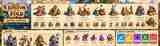

# Kingdom of the Fold — Expanded Unit Roster

**Design proposal v1.0 · 20 October 2026**

This is the detailed roster companion to [`docs/GDD.md`](GDD.md). It expands the five established tower families, two established heroes and five established enemy archetypes into a larger roster while preserving the newer **Hand-Folded Fantasy** art direction in [`docs/art/STYLE.md`](art/STYLE.md).

## Status labels

- **Established/current:** present in the GDD or current Godot content. Numbers labelled current are from `godot/content/`.
- **GDD-defined / implementation pending:** specified in design, but not necessarily implemented in the running game.
- **Proposed:** new design content. Draft numbers are untested starting points and are not production balance values.

## Roster at a glance

| Category | Count | Status |
|---|---:|---|
| Tower families | 8 | 5 established; 3 proposed |
| Tier-IV specialisations | 16 | 10 established in the GDD; 6 proposed |
| Heroes | 4 | Knight and Camp Cook established in GDD; Foldrunner and Lantern Scribe proposed |
| Enemy archetypes | 12 | 5 established; 7 proposed |
| Bosses | 3 | Cardboard Golem established; The Binder and Inkheart Colossus proposed |
| Global craft spells | 3 | GDD-defined; keep distinct from tower/hero actives |

## Visual roster reference

[Open the editable roster schematic](art/roster/roster-overview.svg).

This sheet is a visual index of the eight tower families, four hero options, and twelve enemy archetypes. It is an orientation aid, not a source of balance values; the tables below are authoritative for names, status, mechanics and draft numbers.

## Visual identity rules

1. **Squarish, not voxel:** chunky bevelled card masses, broad planes and slightly imperfect shapes; no perfect stacked cubes.
2. **Painterly, not flat:** warm sunlit planes, cool shadow colour, broad gradients and contact shading; no toon bands or black cartoon outlines.
3. **Paper, not plastic:** matte cardstock, kraft, layered edges, fold lines, glued tabs and selective corrugation. Gloss is reserved for water, magic and wet Blot ink.
4. **Readable at gameplay distance:** silhouette, movement profile, colour family and one signature prop must communicate the role.
5. **Faction distinction:** allied structures use kraft/cream/wood with restrained kingdom-blue and gold details. Corrupted foes use torn/offset layers, umber and moss tones plus controlled purple stains. Purple does not cover every enemy; friendly magic is cyan.

Render sheets with the same elevated three-quarter camera, warm amber key light from upper-left, cool pale-blue fill, strong soft contact shadows, mild distance haze and restrained depth-of-field. Keep the route, tower sockets, bridge holds, and feet of units unobscured.

## Towers

### T1 — Spool Guard (established/current)

**Role:** rapid physical single-target damage; anti-air; reliable early tower.

**Model identity:** a large wooden thread spool with red or cream thread winding, a cream label, a four-hole button turntable, a toothpick/lolly-stick ballista, paper-strip darts and a small kingdom-blue pennant. Its weapon turns to aim. It must read as a spool at thumbnail size and remain a horizontal silhouette distinct from the vertical Prism Spire.

**Current simulation values (levels I / II / III):** cost 50 / 60 / 110 Buttons; damage 12 / 20 / 33 per shot; range 2.3 / 2.6 / 3.0 cells; rate 3.0 / 3.6 / 4.5 shots/sec; anti-air enabled.

- **Tier IV A — Crossbow Ballista:** active **Heavy Skewer** fires a heavy bolt through up to five aligned foes and applies bleed; passive **Armour Piercing** ignores 40% of armour. Visual: thicker laminated stock, larger bow limbs, prominent cream bolt.
- **Tier IV B — Paper-Plane Aviary:** active **Squadron Launch** dispatches three folded planes that patrol and drop bombs/darts; passive **High Recon** increases the range of nearby towers by 20%. Visual: nest-like paper roost and three distinct plane silhouettes.

**Animation:** subtle spool wobble; short stepped weapon recoil; dart snap; a visible paper-dart reload.

### T2 — Thimble Mortar (established/current)

**Role:** slow-firing ground splash damage against clustered foes.

**Model identity:** a squat dull-grey sewing thimble nested in a thick kraft-cardboard cradle, oversized short barrel, folded retaining straps and tiny blue pennant. Its broad horizontal mass contrasts with the Spool Guard.

**Current simulation values (levels I / II / III):** cost 90 / 90 / 160; damage 19 / 34 / 58 per shot; range 2.8 / 3.1 / 3.5 cells; rate 0.7 / 0.8 / 0.95 shots/sec; splash radius 0.95 / 1.15 / 1.35 cells; ground-only.

- **Tier IV A — Glitter Cannon:** active **Confetti Burst** deals area damage and blinds melee attackers; passive **Shrapnel Spread** increases splash radius by 35%. Visual: broader shell hopper and restrained gold paper confetti.
- **Tier IV B — Sticky Glue Mortar:** active **PVA Deluge** creates a glue field that slows foes by 70% for six seconds; passive **Lingering Residue** leaves slowing pools for four seconds after impacts. Visual: cream glue globules and a folded-paper splash skirt; avoid glossy plastic-like glue.

**Animation:** barrel dips on reload, rises before firing, then recoils; shell arc and impact remain readable.

### T3 — Prism Spire (established/current)

**Role:** sustained magical beam damage; anti-air; answer to armour.

**Model identity:** tall narrow rolled-paper tower, stepped cardstock rings, single faceted cyan glass-marble prism at the crown. The prism is allowed a restrained magical gloss; all other surfaces stay matte.

**Current simulation values (levels I / II / III):** cost 100 / 90 / 160; damage 34 / 68 / 132 per second; range 2.3 / 2.6 / 2.9 cells; continuous beam; anti-air enabled.

- **Tier IV A — Cryo-Origami Spire:** active **Flash Freeze** freezes eligible foes in range for three seconds; passive **Frostbite** makes slowed/frozen foes take +20% physical damage. Visual: folded blue-white crystal petals and frost-edged paper.
- **Tier IV B — Blot Singularity:** active **Ink Vortex** pulls eligible light ground foes towards a target point; passive **Corrosive Light** strips armour by 2% per second up to 50%. Visual: crooked violet facets and a contained ink eddy. Purple corruption remains localised.

**Animation:** crown turns in stepped increments; cyan energy gathers before the beam; ground glow stays localised.

### T4 — Guard Tent (established/current)

**Role:** deploys two melee guards to hold eligible ground foes and buy firing time.

**Model identity:** folded cream/red A-frame paper tent with ridge crease, door flap, thread guy-lines, sewing-pin pegs, shield and toothpick spear by the entrance, and blue pennant.

**Current simulation values (levels I / II / III):** cost 55 / 65 / 110; two guards; guard HP 120 / 200 / 320; armour 0 / 2 / 4; damage 16 / 28 / 48 per blow; 1 s attack interval; respawn 6 / 5 / 4 s; out-of-combat regeneration 1 / 1.5 / 2 HP/s. Heavy bosses are not blockable.

- **Tier IV A — Cardboard Knights:** active **Shield Wall** increases guard armour for a limited time; passive **Corrugated Plating** reflects 15% of received melee damage as true damage. Visual: broad corrugated shields, squared helmets, layered blue tabards.
- **Tier IV B — Scissor Rogues:** active **Precision Snipe** sends a guard to hit a priority target for high damage; passive **Paper Cuts** applies a 10% slow per hit, stacking up to three times. Visual: narrow asymmetric hoods and paired folded blades.

**Animation:** tent door flips open as guards emerge with short stop-motion steps. Guards must look like paper puppets, not plastic soldiers.

### T5 — Kitchen Mess Tent (established/current)

**Role:** support aura for Guard Tent defenders.

**Model identity:** squat, broad cream/kraft pavilion with folded roof, blue cloth banner, pot-and-ladle crest, amber lantern and ration bundles. It must read wider and more welcoming than the Guard Tent.

**Current simulation values (levels I / II / III):** cost 100 / 100 / 160; aura radius 3.0 / 3.3 / 3.6 cells; guard attack-speed bonus +12% / +18% / +25%; guard regeneration +2 / +3 / +4 HP/s.

- **Tier IV A — Iron Rations:** active **Fortified Feast** shields friendly troops nearby; passive **Hardtack Toughness** increases nearby guards' maximum HP by 30%. Visual: thick ration bundles and shield pennants.
- **Tier IV B — Gourmet Frenzy:** active **Boiling Broth Splash** burns and slows enemies in an area; passive **Sugar Rush** increases movement and attack speed of nearby hero and guards by 25%. Visual: warm orange broth arc and lively banners.

These specialisations are GDD-defined; verify their registration in `godot/content/specs.gd` before implementation.

### T6 — Quillwatch Beacon (proposed)

**Role:** target-marking support; helps all towers focus dangerous enemies. Less raw damage than the Spool Guard.

**Model identity:** tall folded-card mast, quill-like pointer, cyan kite lens, stepped kraft base, narrow blue signal pennant and optional folded falcon finial. Its vertical needle-and-kite silhouette must not resemble the Spool Guard's horizontal ballista.

**Draft tuning (levels I / II / III):** cost 75 / 85 / 125; damage 5 / 7 / 10; range 3.4 / 3.8 / 4.2 cells; rate 0.8 / 1.0 / 1.1 shots/sec; ground-only. Hits mark the target for two seconds; other towers deal +8% / +12% / +16% damage to marked foes. Marks do not stack; strongest applies.

- **Tier IV A — Falcon's Eye:** active **Call the Shot** marks up to four nearby foes for five seconds; passive strengthens the mark bonus. Visual: an angular paper falcon finial.
- **Tier IV B — Paper Squadron:** every fifth hit launches two tiny paper birds at the marked target; passive increases mark duration. Visual: two origami birds perched on the mast.

**Synergy:** Prism Spire against armoured priority targets; Spool Guard against a fast elite; Guard Tent holds a marked foe in tower range.

### T7 — Briar Loom (proposed)

**Role:** controlled route snare and timing setup; low direct damage.

**Model identity:** low forked timber-and-card frame anchored to the terrain, green folded leaves and cream/brown tensioned cords forming a clear X. Avoid tangles of hair-thin string and realistic vines.

**Draft tuning (levels I / II / III):** cost 80 / 90 / 135; control reach 2.2 / 2.4 / 2.7 cells; activation interval 7.0 / 5.5 / 4.5 s; no direct damage. Ground foes are slowed by 22% / 30% / 35% for 1.6 s. Small foes may be briefly snagged; heavy foes and bosses are slowed only. Strongest slow wins and refreshes duration; slows must not stack indefinitely.

- **Tier IV A — Knotwarden's Snare:** active **Grand Knot** briefly roots non-heavy foes in a small area; passive adds a short snag to light enemies. Visual: thicker crossing cords and a knot motif.
- **Tier IV B — Thorn-Thread Weave:** active **Snarlburst** splays folded thorns and reapplies a short slow; passive adds a small paper-cut damage-over-time effect to snared foes. Visual: angular leaf/thorn folds.

**Synergy:** Thimble Mortar against grouped foes, Prism Spire against controlled targets, Guard Tent on a bridge. It should be weaker in open ground.

### T8 — Button Press (proposed)

**Role:** capped economic utility, trading immediate damage for delayed income.

**Model identity:** compact fantasy mint-house/press with two stacked wood/card plates, round stamp head, button-token tray and a small blue-and-gold guild pennant. Not a modern office machine or craft-desk prop.

**Draft tuning (levels I / II / III):** cost 110 / 110 / 150; radius 2.4 / 2.7 / 3.0 cells; +1 / +2 / +2 Buttons per eligible kill; per-wave caps 8 / 12 / 16. Only eligible non-summoned enemies count. Never pays on summoned adds or a kill already credited to another Press.

- **Tier IV A — Bounty Press:** active **Close the Books** triggers a limited payout after a wave condition; passive increases the cap and grants a modest elite-kill bonus. Visual: second stamping plate and ledger banner.
- **Tier IV B — Royal Seal:** active **War Writ** grants nearby towers +18% fire rate for five seconds; passive reduces adjacent tower upgrade costs by 10%. Visual: prominent blue-and-gold seal plate.

**Balance constraint:** several waves should be needed to repay the cost. It must not be a mandatory opening purchase or create recursive income.

### Tower role matrix

| Tower | Single target | Splash | Anti-air | Block | Control | Support | Economy |
|---|---:|---:|---:|---:|---:|---:|---:|
| Spool Guard | Strong | — | Yes | — | — | — | — |
| Thimble Mortar | — | Strong | No | — | Branch | — | — |
| Prism Spire | Strong magic | — | Yes | — | Freeze/pull | Debuff | — |
| Guard Tent | Melee | Limited | No | Yes | Branch | — | — |
| Kitchen Mess Tent | — | — | — | — | Branch | Guard aura | — |
| Quillwatch Beacon | Low | — | No | — | Mark | Focus-fire amp | — |
| Briar Loom | — | — | No | — | Strong | — | — |
| Button Press | — | — | No | — | — | Tower buffs | Capped income |

## Heroes

The initial release should allow one directly commanded hero at a time. Additional heroes are selectable/unlockable, not independently commanded by the player simultaneously.

### H1 — Knight of Cardboard (established in GDD)

**Role:** frontline, mobile blocker, emergency crowd clear.  
**Visual:** broad squarish head/torso; layered blue cardstock armour; cream tabs; kite shield with gold fold mark; short folded sword. Matte paper armour, not metal plate.

- **Passive — Rally Cry:** friendly units within 3 cells gain +15% attack speed and +10% HP regeneration.
- **Active — Blade Whirl:** area physical damage to adjacent ground foes; GDD cooldown 15 s.
- **Strength:** stabilises a breach, protects guards and clears light groups.
- **Weakness:** limited reach; must move to the threat; cannot answer distant flyers alone.

### H2 — Camp Cook (established in GDD; implementation status to verify)

**Role:** support/control with a short-range area throw.  
**Visual:** folded recipe-paper apron/cape, tied ration satchel, oversized matte ladle, cream/kraft/ochre and small blue details; wider silhouette than the Knight, no large shield.

- **Passive — Rations and Morale:** nearby troops heal 2% HP/s and gain +10% damage resistance, per GDD.
- **Active — Boiling Stew Splash:** target-area burn and 40% slow for 5 s.
- **Strength:** improves guard staying power and helps a chokepoint hold.
- **Weakness:** short threat radius and lower direct burst than the Knight.
- **Design distinction:** do not merge the Camp Cook with the Kitchen Mess Tent; reuse motifs, not silhouette or function.

### H3 — Foldrunner (proposed)

**Role:** fast mobile hunter and responder.  
**Visual:** agile but still squarish paper scout, asymmetric moss-green folded hood/cloak, light kraft armour, twin broad paper blades and one kingdom-blue trail ribbon.

- **Passive — Roadwise:** moves faster along the route and reduces selected ground-control penalties.
- **Active — Severing Dash:** dashes toward a target and cuts foes along the line.
- **Strength:** intercepts fast threats and reaches support enemies.
- **Weakness:** fragile, limited boss damage without tower support.
- **Unlock:** later progression, after hero movement and collision are stable.

### H4 — Lantern Scribe (proposed)

**Role:** ranged support and dispel specialist.  
**Visual:** cream/navy layered scroll robes, quill-like staff, cyan lantern crystal and offset paper collar. Use cyan friendly magic, never the Blot's purple as the dominant light.

- **Passive — Clear Script:** weakens the duration of nearby enemy buffs.
- **Active — Unblot the Page:** removes eligible non-boss shields/buffs and applies a brief area slow.
- **Strength:** counters Ink Shaman/Acolyte formations.
- **Weakness:** low durability and low raw damage.
- **Unlock:** later content; use the shared status/dispel system rather than special-case logic.

## Enemies

### Established enemies and current simulation baselines

Values below are from `godot/content/foes.gd`; they are not new tuning proposals.

| Enemy | Role | HP | Speed cells/s | Armour | Reward | Leak | Behaviour |
|---|---|---:|---:|---:|---:|---:|---|
| Scrap Goblin | Swarm | 20 | 1.60 | 0 | 4 | 1 | Fast and fragile; blockable; weak to splash |
| Corrugated Orc | Armoured bruiser | 130 | 0.57 | 6 | 13 | 2 | Slow and durable; blockable |
| Ink Shaman | Support | 60 | 0.90 | 0 | 10 | 1 | 1.6-cell aura; heals 4% max HP/s and adds 25% speed; auras do not stack |
| Razor Moth | Flyer | 35 | 1.10 | 0 | 7 | 1 | Flies directly toward objective; only anti-air towers can hit it |
| Cardboard Golem | Boss | 850 | 0.42 | 6 | 110 | 6 | Heavy, un-blockable; spawns four Scrap Goblins on defeat |

### Proposed enemy additions

All numbers are draft starting points. New behaviour may require shared systems that do not yet exist.

| Enemy | Draft stats | Behaviour and counter |
|---|---|---|
| Tackrunner | 16 HP; 2.0 cells/s; 0 armour; 3 Buttons; 1 leak | Brief speed burst; counter with Spool Guard, Knight or Briar Loom |
| Glue Ooze | 85 HP; 0.55 cells/s; 1 armour; 8 Buttons; 1 leak | Leaves a short-lived sticky road patch that disrupts mobile defenders; counter with ranged/splash damage |
| Ink Acolyte | 70 HP; 0.78 cells/s; 0 armour; 11 Buttons; 1 leak | Gives a nearby foe a temporary shield worth 10% of max HP; counter with focus fire, magic or dispel |
| Waxbound Beetle | 180 HP; 0.43 cells/s; 4 armour; 30% magic resistance; 18 Buttons; 2 leak | Slow magic-resistant heavy; counter with physical damage and armour piercing |
| Paperwing Bomber | 90 HP; 0.95 cells/s; 0 armour; 14 Buttons; 2 leak | Heavy flyer; drops a telegraphed temporary ink hazard; counter with anti-air |
| The Binder | 1,500 HP; 0.32 cells/s; 5 armour; 160 Buttons; 8 leak | Un-blockable summoner boss; summons capped goblin groups; counter with focused damage and area coverage |
| Inkheart Colossus | 3,000 HP; 0.28 cells/s; 2 armour; 20% magic resistance; 250 Buttons; 10 leak | Proposed final boss; phases at 70% and 35% HP, telegraphed ink hazard and capped adds, brief exposed-core damage window |

### Threat/counter principles

- Goblin packs test area damage; Tackrunners test response time.
- Corrugated Orcs and Waxbound Beetles test sustained physical damage and armour counterplay.
- Razor Moths and Paperwing Bombers test explicit anti-air coverage.
- Ink Shaman and Ink Acolyte test target priority and dispel choices.
- Glue Ooze changes defender positioning; its hazard must be telegraphed.
- The Cardboard Golem, The Binder and Inkheart Colossus are not blockable. Boss control is reduced; avoid long hard-stun loops.
- No enemy should require one specific tower to be defeated, but each should reward a sensible counter.

## Global craft spells and naming reconciliation

The three GDD-defined global spells are:

1. **PVA Glue Trap:** coats a route segment; slows ground foes by 60% for 8 seconds.
2. **Falling Thumbtacks:** damages a 2 × 2 target area and briefly makes light foes stumble.
3. **The Crafter's Eraser:** removes eligible non-boss armour, shields and positive magical buffs in a target radius.

These are distinct from tower and hero abilities. Later HUD concepts show **Ice Dart, Glue Patch, Ink Bomb, Reinforce and Confetti Blast**; treat these as unconfirmed UI-concept names until each card is classified as a tower skill, hero skill or global spell. Do not ship duplicate Glue Trap/Glue Patch effects under two names without a design decision.

## 20-wave introduction outline

This is a curriculum proposal, not a final spawn schedule. Final counts/timing need simulation and difficulty testing.

| Wave | Lesson | Composition idea |
|---:|---|---|
| 1 | Single-target basics | Small Scrap Goblin pack |
| 2 | Quantity and splash | Two spaced Goblin groups |
| 3 | First armour check | Goblins + one Corrugated Orc |
| 4 | Anti-air | First Razor Moth with ground escort |
| 5 | Support priority | Ink Shaman behind Goblins |
| 6 | Reaction timing | Tackrunners in a small pack |
| 7 | Ground hazard | Glue Ooze with Orcs |
| 8 | Shield support | Ink Acolyte protected by common foes |
| 9 | Damage-type trade-off | Waxbound Beetle and ordinary foes |
| 10 | First boss exam | Cardboard Golem with small escort |
| 11 | Air pressure | Paperwing Bomber + Razor Moths |
| 12 | Layered support | Shaman + Acolyte + Orcs, low counts |
| 13 | Speed versus armour | Tackrunners ahead of Orcs |
| 14 | Control and crowding | Goblins + Ooze + Shaman |
| 15 | Summoning boss | The Binder, if campaign-unlocked |
| 16 | Combined roles | Armour, support and limited flyers |
| 17 | Upgrade/economy choice | Dense mixed wave with income opportunity |
| 18 | High pressure | Golem + airborne escort + support |
| 19 | Final preparation | Mixed elites; no new mechanic |
| 20 | Final boss | Inkheart Colossus with capped adds |

Fairness: introduce one new mechanic at a time; use the Messenger Crow for flyer/boss warnings; make boss phases visible through animation and ground decals; keep off-screen enemy indicators and minimap requirements on the backlog.

## Synergy recipes

- **Bridge Hold:** Guard Tent + Kitchen Mess Tent with Spool Guard behind them.
- **Marked Target:** Quillwatch Beacon + Prism Spire for focused damage against high-value foes.
- **Crowd Funnel:** Briar Loom + Thimble Mortar; control timing enables splash.
- **Anti-Armour Line:** Prism Spire or Crossbow Ballista plus area damage against escorts.
- **Economy Bet:** Button Press on a high-traffic segment covered by other towers; it must compete with a damage/control site.
- **Anti-Support:** Quillwatch marks the Shaman/Acolyte; hero responds while towers keep escort enemies under control.

## Implementation contract and phases

Keep simulation content data-first with stable IDs independent of display names. Store implemented numbers in `godot/content/`; keep proposals in this document until the feature is implemented and balance-tested.

**Phase A — core:** Spool Guard, Thimble Mortar, Prism Spire, Guard Tent, Knight, five established foes, Heartstone/Heartkeep, route and socket readability.

**Phase B — GDD completion:** Kitchen Mess Tent support, Camp Cook, existing Tier-IV branches, three global spells, shared status effects and guard/boss interactions.

**Phase C — enemy expansion:** Tackrunner, Ink Acolyte, Waxbound Beetle, Paperwing Bomber, then The Binder.

**Phase D — tactical towers:** Quillwatch Beacon and Briar Loom; implement marks/control in shared status code first.

**Phase E — long-term content:** Button Press, Foldrunner, Lantern Scribe and Inkheart Colossus.

### Asset acceptance checklist

- [ ] Reads at the default 32 × 20 valley overview.
- [ ] Silhouette differs from every same-role unit.
- [ ] Matte paper/card materials; no voxel stacks or toy-plastic specular.
- [ ] Warm key light, cool fill and visible contact shadows.
- [ ] Friendly vs Blot palette is immediately legible.
- [ ] Animation/VFX communicate attack timing and area without hiding feet, route, guards or targeting.
- [ ] Remains readable on the Godot Mobile renderer.
- [ ] Art-only changes preserve stable IDs and combat definitions.
